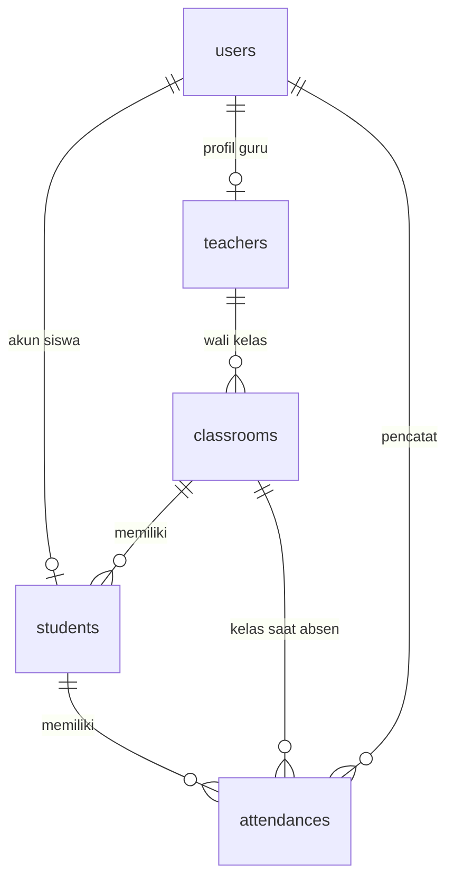

# School Attendance Management System

Aplikasi web absensi siswa untuk sekolah, dibuat sebagai proyek akhir magang SMK. Admin mengelola data sekolah, guru mencatat absensi harian kelasnya, dan siswa melihat riwayat kehadirannya sendiri. Aplikasi memakai backend Laravel dan database MySQL sungguhan, bukan data dummy.

## Fitur Utama

- Autentikasi: register siswa (via NIS), login, logout, rate limit percobaan login dan register
- Role-Based Access Control: Admin, Guru, Siswa (middleware + policy)
- Manajemen kelas (CRUD, wali kelas, pencarian)
- Manajemen siswa (CRUD, filter kelas/status, pembuatan akun login siswa)
- Absensi harian massal: Hadir, Izin, Sakit, Alpa, dengan catatan opsional
- Dashboard per role dengan statistik dari database dan grafik kehadiran 7 hari kerja
- Tampilan responsif (desktop, tablet, HP)

## Peran dan Hak Akses

| Fitur | Admin | Guru | Siswa |
|---|---|---|---|
| Kelola kelas dan siswa | ✅ | ❌ | ❌ |
| Catat dan edit absensi | ✅ semua kelas | ✅ kelas miliknya, maksimal 7 hari ke belakang | ❌ |
| Dashboard | Statistik sekolah | Status kelas miliknya | Riwayat miliknya |

## Teknologi

- PHP 8.3, Laravel 12
- MySQL 8
- Blade + Tailwind CSS 4 (Vite)
- Chart.js untuk grafik
- Git dan GitHub

## Desain Database



Aturan penting: `attendances` memiliki unique `(student_id, date)` sehingga satu siswa hanya punya satu catatan per tanggal. Tanggal absensi (`date`) dipisahkan dari waktu pencatatan (`created_at`). Foreign key ke data absensi memakai `restrict`, jadi siswa dan kelas yang punya riwayat tidak bisa dihapus; cukup dinonaktifkan.

## Persyaratan

- PHP 8.2 atau lebih baru (diuji dengan 8.3)
- Composer 2
- Node.js 20 atau lebih baru dan npm
- MySQL 8
- Git

Di Windows, Laragon sudah menyediakan PHP, Composer, MySQL, dan Node.

## Instalasi

1. Clone repository dan masuk ke foldernya
```bash
   git clone https://github.com/ZuriZIBZIB/school-attendance.git
   cd school-attendance
```
2. Install dependency
```bash
   composer install
   npm install
```
3. Salin file environment dan buat application key
```bash
   cp .env.example .env
   php artisan key:generate
```
   Di Windows PowerShell/CMD: `copy .env.example .env`
4. Buat database MySQL
```bash
   mysql -u root -e "CREATE DATABASE school_attendance CHARACTER SET utf8mb4 COLLATE utf8mb4_unicode_ci;"
```
5. Sesuaikan koneksi database di `.env` bila perlu
```env
   DB_CONNECTION=mysql
   DB_HOST=127.0.0.1
   DB_PORT=3306
   DB_DATABASE=school_attendance
   DB_USERNAME=root
   DB_PASSWORD=
```
6. Jalankan migration dan seeder
```bash
   php artisan migrate --seed
```
7. Build aset frontend, lalu jalankan aplikasi
```bash
   npm run build
   php artisan serve
```
   Buka http://127.0.0.1:8000

Untuk pengembangan, jalankan `npm run dev` di terminal terpisah agar perubahan tampilan langsung terlihat.

## Akun Demo (khusus lokal)

Semua akun memakai password `password`. Data seeder fiktif dan hanya untuk pengembangan lokal; jangan dipakai di server publik.

| Role | Email |
|---|---|
| Admin | `admin@sekolah.test` |
| Guru (wali X RPL 1) | `guru1@sekolah.test` |
| Guru (wali XI RPL 1) | `guru2@sekolah.test` |
| Guru (wali XII RPL 1) | `guru3@sekolah.test` |
| Siswa | `siswa1@sekolah.test` sampai `siswa6@sekolah.test` |

Untuk mencoba pendaftaran siswa, buka `/register` dan gunakan NIS yang belum punya akun, misalnya `20260003`.

## Aturan Absensi

- Satu siswa hanya memiliki satu catatan absensi per tanggal
- Guru hanya dapat mencatat kelas yang menjadi tanggung jawabnya, dari hari ini sampai 7 hari ke belakang; tanggal mendatang ditolak
- Admin dapat mengoreksi absensi semua kelas
- Semua siswa aktif di kelas harus terisi, dan penyimpanan massal berjalan dalam satu transaksi database
- Persentase kehadiran dihitung dari jumlah Hadir dibagi total catatan

## Keamanan

- Password di-hash dengan mekanisme Laravel
- Proteksi CSRF bawaan Laravel dan validasi input di sisi server
- Akses dibatasi oleh middleware role dan policy; siswa hanya melihat data miliknya
- File `.env` tidak ikut di-commit

## Batasan

- Tidak ada validasi lokasi, biometrik, atau fitur anti-kecurangan
- Pendaftaran siswa memakai NIS sebagai kunci klaim akun